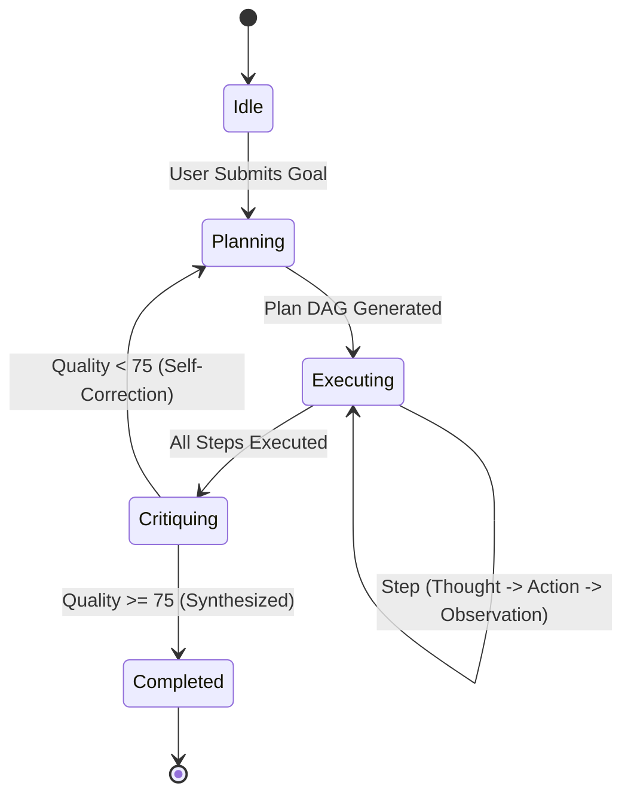

# Module 02: Multi-Agent Orchestration & State Transition Mechanics

## 1. Node Topology & Responsibilities

The AgentFlow Studio orchestration engine coordinates three autonomous roles under an event-driven state machine.



---

## 2. Deep Dive: Agent Node Implementations

### 2.1 The Planner Node (`PlannerAgent`)
The Planner performs goal decomposition into discrete `PlanStep` instances:

```typescript
export interface PlanStep {
  id: string;
  order: number;
  description: string;
  toolToUse?: string;
  toolArgsHint?: Record<string, any>;
  dependencies: string[];
  status: StepStatus;
  output?: string;
}
```

- **Intent Recognition**: Evaluates keywords and semantic tokens (e.g., mathematical evaluation, architecture queries, system telemetry) to structure the step sequence.
- **Dependency Graph**: Enforces step dependencies (e.g., Step 2 cannot execute until Step 1 provides ground-truth observation data).
- **Plan Revision**: Exposes `revisePlan(currentPlan, feedback)` to dynamically append remediation steps when triggered by the Critic.

### 2.2 The Executor Node (`ExecutorAgent`)
The Executor implements the ReAct loop:
1. **Thought**: Constructs reasoning based on prior step observations and current dependencies.
2. **Action**: Dispatches an `MCPToolCall` to the `MCPRegistry`.
3. **Observation**: Formats the returned `MCPToolResult` and logs execution time and error states.

### 2.3 The Critic Node (`CriticAgent`)
The Critic acts as the verification gatekeeper:
- **Evaluation Matrix**: Checks tool execution statuses, coverage of prompt constraints, and mathematical validity.
- **Hallucination Detection**: Assesses whether intermediate thoughts contradict retrieved RAG chunks.
- **Self-Correction Heuristic**: If score $< 75$, outputs a `CritiqueResult` with `shouldRetry = true` and actionable revision guidance. Hard bounded at 1 retry to eliminate infinite cycles.

---

## 3. Deadlock & Cascade Prevention Strategy

1. **Acyclic Verification**: Dependencies must be strictly progressive (`step_n` depends only on `step_k` where $k < n$).
2. **Hard Timeout Safeguards**: Each step is bounded by tool execution timeouts. If a tool fails, the state machine records the error and allows the Critic to decide on recovery rather than freezing the pipeline.
3. **Graceful Degradation**: If revisions fail to meet the quality score threshold, the final synthesis surfaces explicit uncertainty flags rather than throwing an unhandled exception.
